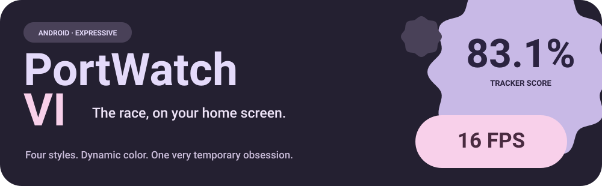
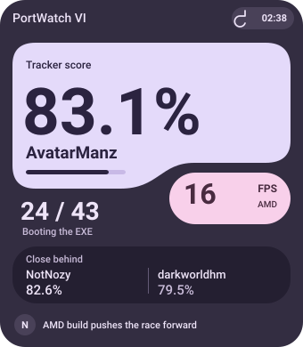
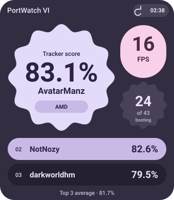
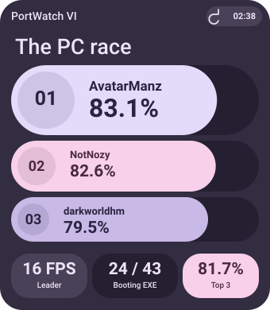
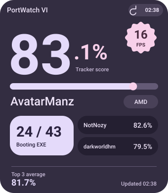

<div align="center">



<br>

[](https://github.com/BadKiko/PortWatchAndroidWidget/releases/tag/v3.0.1)
[](https://github.com/BadKiko/PortWatchAndroidWidget/actions/workflows/build.yml)


**The GTA VI PC porting race, without refreshing a browser every five minutes.**

An unofficial, native Android home-screen widget for [PortWatch VI](https://portwatch-vi.xyz/), inspired by Material 3 Expressive.

</div>

> [!NOTE]
> **A project with an expiration date.** This exists for the race, not forever. Once the porting race is over, the project will have served its purpose and there is little reason to keep developing it.
>
> **Author's note:** built in around 20 minutes with the help of Codex — a small AI-assisted experiment, not a long-term product.

## Choose your expression

<div align="center">
<table>
<tr>
<td align="center" width="50%"><br><b>01 · Liquid Expressive</b><br><sub>Fluid geometry, asymmetry and oversized type.</sub></td>
<td align="center" width="50%"><br><b>02 · Organic Shapes</b><br><sub>Soft scalloped shapes and bold tonal accents.</sub></td>
</tr>
<tr>
<td align="center"><br><b>03 · Pixel Racing</b><br><sub>A leaderboard built around the race itself.</sub></td>
<td align="center"><br><b>04 · Editorial Minimal</b><br><sub>Big numbers, generous space and a quiet rhythm.</sub></td>
</tr>
</table>
<sub>Illustrative SVG previews with sample data and a lavender Monet palette. Actual colors, text, dimensions and tracker values vary by device.</sub>
</div>

## Small widget. Big obsession.

- **Four designs, twelve layouts:** dedicated 2×2, 4×2 and large compositions for each design.
- **Real dynamic color:** system Monet resources on Android 12+, light/dark/system themes and fallback colors on earlier versions.
- **Live tracker data:** leader, score, reported FPS, top three and EXE boot statistics. Scores are tracker metrics, not a literal percentage of port completion.
- **Your GPU, your race:** AMD / NVIDIA / all-project filters. Projects without recognized GPU metadata appear in the all-project view.
- **News:** Russian translation with original-text fallback, shown in supported large layouts.
- **Your home screen:** resizable widgets, in-app preview, adaptive icon and Android 13+ monochrome themed icon.
- **Refresh your way:** tap to refresh or choose 15, 30 or 60 minutes; Android may defer background jobs. Last successful data is cached.

## Installation

1. Get the APK from [Releases](https://github.com/BadKiko/PortWatchAndroidWidget/releases/tag/v3.0.1).
2. Install it (Android may ask for permission to install from your browser).
3. Open PortWatch VI, choose a design and tap **Add to home screen**, or add it through your launcher's widget picker.
4. Resize the widget as desired. Style, theme and GPU filter apply globally to installed widgets.

This is a debug-signed build. If an earlier APK was signed with a different key, Android may require uninstalling it first, which removes local settings.

## Under the hood

Native Java · Canvas · RemoteViews · JobScheduler · Android SDK 35 · Gradle 8.9 · no third-party libraries.

```bash
gradle :app:assembleDebug
```

Requires JDK 17 and Android SDK 35. The APK is built through [GitHub Actions](https://github.com/BadKiko/PortWatchAndroidWidget/actions).

The widget fetches public statistics from PortWatch VI and sends news text to Google's translation endpoint when a translation is needed. No accounts are required by the app.

## Credits & scope

- [PortWatch VI](https://portwatch-vi.xyz/) — the public tracker and source of statistics.
- Android / Material Design — visual inspiration.
- This app is not a game, emulator, port or downloader. It contains no game files, keys or executables from GTA VI. It is not affiliated with Rockstar Games, Take-Two, Microsoft or PortWatch VI.

<div align="center">

**Made for the race. Not for eternity.**

<sub>Built fast · Designed for the home screen · Here until the finish line</sub>

</div>
